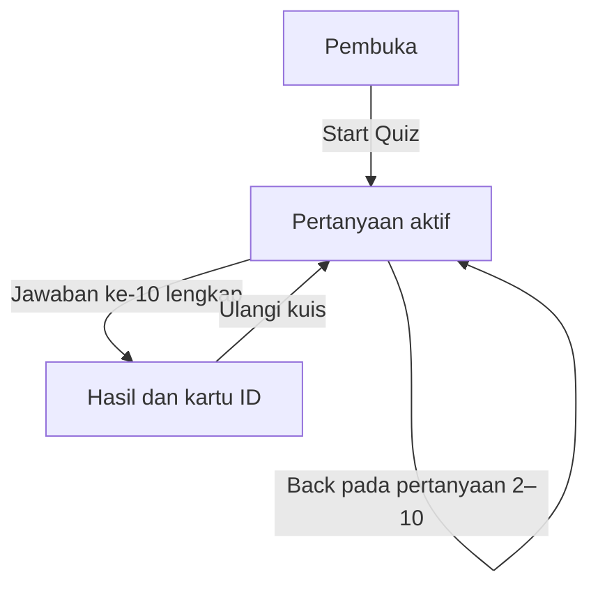

# Design — Which Trauma Code Character Are You?

Status: Draf desain berdasarkan requirement revisi 4  
Tanggal: 28 Oktober 2026  
Spesifikasi aktif: `requirement.md`  
Lingkup: rancangan pengalaman, visual, konten, logika, struktur aplikasi, dan verifikasi. Implementasi serta verifikasi T01–T16 dan T18 selesai; T17 menunggu uji Firefox desktop serta Android/iPhone nyata. Bukti aktual tersedia di `docs/verification.md`.

### Acuan steering untuk agen AI

| Panduan | Hubungan dengan desain |
| --- | --- |
| [project-overview.md](../steeering/project-overview.md) | Konteks produk, target pengguna, lingkup, batasan, dan alur kerja SDD. |
| [feature-behavior.md](../steeering/feature-behavior.md) | Panduan perilaku untuk alur layar, jawaban, skor, hasil, reset, serta penanganan kasus tepi pada bagian 2, 5, dan 7. |
| [ui-accessibility.md](../steeering/ui-accessibility.md) | Panduan tampilan dan aksesibilitas untuk layout, kedalaman, efek mengikuti mouse, fokus, serta gambar pada bagian 2–3, 8, dan 11. |
| [coding-conventions.md](../steeering/coding-conventions.md) | Konvensi implementasi arsitektur, state/event, render DOM, CSS, efek pointer, serta pemeriksa pada bagian 3.6, 7, dan 9. |

Gunakan requirement sebagai sumber kebutuhan dan dokumen ini sebagai sumber keputusan desain. Steering memandu implementasi secara konsisten; target skor, batas gerakan, dan kriteria penerimaan tetap mengikuti spesifikasi aktif. Jika pengguna meminta perubahan, selaraskan dokumen yang terdampak sebelum menerapkannya.

## 1. Keputusan utama

Website memakai satu halaman HTML dengan tiga layar: pembuka, kuis, dan hasil. Semua data serta perhitungan tersedia di browser. Tidak memerlukan framework, build, npm, backend, database, AI, atau akun pengguna.

Arah visualnya adalah **ruang trauma bergaya sinematis dengan kartu identitas staf yang memiliki kedalaman**. Kedalaman dibuat dengan CSS: lapisan, cahaya, gradasi, batas permukaan, bayangan, dan perubahan posisi yang kecil. Tidak membutuhkan mesin 3D atau gambar berukuran besar.

Fokus awal adalah Gen Z Indonesia usia 18–27 tahun yang menyukai K-drama. Teks pertanyaan dan penjelasan memakai bahasa Indonesia yang santai serta jelas. Judul proyek dan label tertentu mengikuti brief. Kesesuaian bahasa dan isi masih perlu diuji kepada pengguna.

Tujuan pengalaman: cepat dipahami, menyenangkan untuk disentuh, dan memberi hasil yang cukup personal untuk dibandingkan dengan teman. Unduh gambar, integrasi berbagi, dan tautan hasil belum masuk MVP.

## 2. Alur dan layar



Memuat ulang halaman dari layar mana pun kembali ke pembuka dengan sesi kosong. Tombol Back browser tidak mengendalikan nomor pertanyaan; tombol Back di dalam kuis yang digunakan untuk mengoreksi jawaban.

### 2.1 Pembuka — FR-01, FR-10

Urutan informasi:

1. Label kecil “FAN-MADE PERSONALITY QUIZ”.
2. Judul “Which Trauma Code Character Are You?”.
3. Pengantar: “Di tengah situasi kacau, kamu jadi penggerak, penenang, atau penyusun rencana? Temukan peranmu di tim trauma.”
4. Informasi “10 pertanyaan · tanpa login”. Estimasi waktu hanya ditambahkan setelah ada pengukuran yang mendukungnya.
5. Tombol utama **Start Quiz**.
6. Pratinjau kartu staf dengan gambar karakter dari internet dan monitor medis dekoratif.
7. Keterangan singkat proyek penggemar nonkomersial dan tidak berafiliasi resmi.

Desktop memakai dua kolom: teks dan tombol di kiri, ilustrasi kartu di kanan. Ponsel memakai satu kolom; judul serta tombol lebih dahulu, ilustrasi setelahnya. Tombol tidak tertutup ilustrasi atau lapisan cahaya.

### 2.2 Kuis — FR-02–FR-05

Susunan dari atas ke bawah: identitas proyek ringkas, indikator “Pertanyaan n/10”, bilah progres, konteks kecil seperti “KERJA TIM”, pertanyaan, dua kartu jawaban sejajar, lalu Back.

Pilihan A tetap di kiri dan B di kanan pada semua ukuran yang disyaratkan. Konten disingkat agar susunan dua kolom tetap terbaca pada lebar 320 px; ukuran huruf tidak diperkecil untuk memaksakan teks masuk. Kartu satu baris mempunyai tinggi yang sama dengan mengikuti pilihan terpanjang.

Back disembunyikan pada pertanyaan pertama. Pada pertanyaan yang dikunjungi ulang, pilihan sebelumnya ditandai dengan garis tepi, tanda centang, dan teks “Dipilih”. Mengaktifkan pilihan lama maupun baru melanjutkan tepat satu pertanyaan. Jawaban lain tidak dihapus.

Tidak ada penghitung waktu, pengurangan poin, pertanyaan jebakan, atau tombol Next.

### 2.3 Hasil — FR-06–FR-10

Urutan tampilan:

1. Judul “Ini peranmu di tim trauma”.
2. Kartu ID dengan nama, gelar, foto karakter dari internet, ringkasan, dan label hiburan.
3. Deskripsi karakter serta tiga kekuatan.
4. “Kenapa kamu cocok?” berisi dua alasan dari jawaban pengguna.
5. Pesan karakter dan tombol **Ulangi kuis**.
6. Keterangan fan-made dan “Untuk hiburan, bukan penilaian psikologis ilmiah atau diagnosis.”

Desktop: kartu di kiri, uraian di kanan. Ponsel: kartu lebih dahulu, uraian di bawah. Tidak ada modal yang perlu ditutup untuk membaca hasil.

Kartu dibatasi sekitar 360 px lebarnya; pada viewport 320 px lebarnya sekitar 288 px dengan tinggi dasar maksimal 400 px. Kartu memuat ringkasan pendek saja. Setelah digulir ke kartu, informasi utama muat dalam satu tangkapan layar 320 × 568 atau 375 × 667 CSS px pada zoom normal. Pada pembesaran teks, tinggi boleh bertambah; keterbacaan didahulukan daripada batas tangkapan layar.

Tidak ada tombol unduh atau berbagi yang belum berfungsi. Pengguna bebas memakai tangkapan layar ponselnya.

## 3. Sistem visual dan kedalaman — NFR-04–NFR-08, NFR-12

### 3.1 Lapisan visual

| Lapisan | Bentuk | Tujuan |
| --- | --- | --- |
| Latar ruang | Biru navy gelap dengan radial gradient yang lembut | Memberi suasana drama medis dan fokus ke pusat layar. |
| Detail lingkungan | Grid sangat samar dan garis monitor dari CSS atau SVG lokal | Memberi identitas medis tanpa bersaing dengan teks. |
| Panel utama | Permukaan biru lebih terang, batas tipis, bayangan luar, highlight bagian atas | Membuat panel terasa berada di depan latar. |
| Kartu interaktif | Gradasi permukaan, bayangan, tepi bawah lebih gelap | Memberi kesan dapat disentuh. |
| Informasi aktif | Aksen karakter, outline, ikon centang, serta label teks | Menunjukkan pilihan dan hasil tanpa mengandalkan warna saja. |

Permukaan teks tetap cukup pekat. Efek kaca dan blur berat tidak menjadi fondasi tampilan. Dekorasi tidak menghalangi klik dan tidak dibaca pembaca layar.

### 3.2 Warna dan tipografi

Token awal berikut adalah keputusan desain; kontras pasangan warna yang benar-benar dipakai tetap harus diukur saat implementasi.

| Token | Nilai awal | Pemakaian |
| --- | --- | --- |
| Latar | `#081321` | Latar halaman. |
| Panel | `#14263B` | Panel dan kartu. |
| Permukaan terangkat | `#1C3650` | Kontrol dan lapisan atas. |
| Teks utama | `#F4F7FB` | Judul dan isi. |
| Teks sekunder | `#BDCADA` | Keterangan; tidak dibuat transparan berlebihan. |
| Aksen umum | `#67E8D3` | Progres, fokus, dan tombol mulai. |

Gunakan font sistem: `system-ui`, `Segoe UI`, lalu sans-serif. Tidak memanggil font eksternal. Teks isi dasar 16 px dengan jarak baris sekitar 1,5; judul responsif 28–56 px. Label dekoratif kecil tidak menjadi satu-satunya tempat informasi penting.

Tombol utama memakai teks navy di atas aksen terang. Teks isi tidak memakai warna aksen dengan kontras rendah. Fokus keyboard memakai outline terang dengan offset yang tetap terlihat di luar bayangan.

### 3.3 Tema karakter

| Kode internal | Karakter | Aksen | Motif pendukung |
| --- | --- | --- | --- |
| B | Baek Kang-hyuk | Amber `#FFC078` | Garis tegas dan chevron arah. |
| Y | Yang Jae-won | Biru `#91C9FF` | Grid catatan dan langkah bertingkat. |
| C | Cheon Jang-mi | Rose `#FFB3C6` | Simpul tim dan garis melengkung. |
| P | Park Gyeong-won | Mint `#7BE0CC` | Gelombang stabil dan lingkaran presisi. |
| H | Han Yu-rim | Lavender `#C9B8FF` | Jalur bercabang dan diagram rencana. |

Nama dan gelar karakter selalu ditampilkan. Aksen diterapkan melalui token tema pada layar hasil; latar, teks, dan fokus tetap konsisten. Foto karakter bersumber dari internet menjadi visual utama kartu hasil. Pilih gambar yang sesuai karakter, cukup tajam saat dipotong, dan mempunyai izin penggunaan yang mendukung proyek. Catat URL halaman sumber, pembuat/pemegang hak jika tersedia, lisensi atau izin, serta atribusi yang diperlukan. Motif pendukung tetap menjadi interpretasi UI fan-made. Identitas proyek tetap menunjukkan status tidak berafiliasi resmi.

### 3.4 Bentuk, tata letak, dan responsivitas

- Sistem jarak: 4, 8, 12, 16, 24, 32, dan 48 px. Sudut panel 24 px; kartu pilihan 18 px; tombol 14 px.
- Lebar konten maksimal 1120 px; area kuis maksimal 760 px. Padding samping 16 px pada ponsel, 24–32 px pada layar lebih besar.
- Di bawah 768 px: pembuka dan hasil satu kolom. Pilihan jawaban tetap dua kolom dengan jarak 8–12 px dan padding kartu 12 px.
- Tinggi target tekan minimal 44 px; kartu jawaban mempunyai tinggi awal sekitar 120–144 px dan dapat bertambah mengikuti teks.
- Halaman memakai tinggi minimal viewport dinamis jika tersedia, dengan cadangan viewport biasa; konten tetap dapat digulir. Tidak mengunci tinggi halaman.
- Hindari teks penting dalam elemen absolut. Gunakan pembungkusan kata, `min-width: 0`, dan ukuran fleksibel untuk nama yang panjang.

### 3.5 Keadaan dan gerakan

| Elemen/peristiwa | Respons | Batas awal |
| --- | --- | --- |
| Hover kartu dengan mouse | Terangkat 4 px, bayangan menguat, batas sedikit lebih terang | 160 ms; hanya perangkat yang mendukung hover. |
| Fokus keyboard | Outline dan highlight setara penekanan visual hover | Langsung; tidak bergantung pada gerakan. |
| Tombol/kartu ditekan | Turun 1–2 px dan bayangan memendek | 80–100 ms; area tekan tetap. |
| Jawaban dipilih | Tanda centang, label, dan tepi aktif muncul | Langsung sebelum transisi. |
| Ganti pertanyaan | Fade dengan pergeseran vertikal maksimal 8 px | Total maksimal 320 ms, termasuk umpan balik pilihan. |
| Progres | Lebar bilah berubah menuju pertanyaan aktif | 180 ms. |
| Hasil muncul | Kartu naik maksimal 12 px dan berubah dari transparan menjadi terlihat | Maksimal 450 ms, tanpa layar “menghitung” buatan. |
| Tilt dan sorotan kartu ID | Permukaan miring maksimal ±3° per sumbu dan sorotan mengikuti mouse | Wajib pada kondisi yang mendukung; rincian bagian 3.6. |
| Parallax dekorasi latar | Dua lapisan mengikuti arah mouse dengan amplitudo berbeda | Wajib pada kondisi yang mendukung; maksimal ±6 px dan ±12 px per sumbu. |

Tilt, sorotan kartu, dan parallax dekorasi adalah syarat MVP pada input mouse yang mendukung dan tanpa reduced motion. Saat efek dinonaktifkan, kartu tetap memiliki kedalaman dari lapisan dan cahaya statis. Tidak ada kebutuhan giroskop, izin sensor, suara otomatis, confetti terus-menerus, atau animasi berkedip.

Dengan `prefers-reduced-motion`, nonaktifkan tilt, pergeseran, dan animasi dekoratif. Pergantian konten berlangsung langsung dengan indikator terpilih tetap tersedia. Pengamanan aktivasi berulang tetap bekerja tanpa menunggu peristiwa akhir animasi.

### 3.6 Interaksi mengikuti mouse — wajib pada kondisi yang mendukung

Cakupan NFR-07 adalah pratinjau kartu ID pada pembuka, kartu ID pada hasil, dan dua lapisan dekorasi latar pada layar aktif. Panel pertanyaan, teks pertanyaan, pilihan jawaban, progres, serta tombol tidak ikut parallax atau tilt. Hover/press biasa tetap mengikuti bagian 3.5.

Efek mengikuti mouse aktif hanya untuk event mouse pada perangkat yang mendukung hover dan fine pointer (`any-hover: hover` dan `any-pointer: fine`), ketika reduced motion tidak aktif dan mode input bukan keyboard. Perangkat hibrida tetap mengabaikan event sentuhan untuk efek ini. Jangan meminta akses sensor atau memakai orientasi ponsel sebagai pengganti.

| Elemen | Pemetaan gerakan | Batas |
| --- | --- | --- |
| Permukaan kartu ID | Posisi pointer relatif terhadap wrapper kartu dipetakan ke koordinat -1 sampai 1, dijepit pada rentang tersebut. `rotateY = x × 3°`, `rotateX = -y × 3°`. Pusat kartu netral. | Maksimal ±3° pada setiap sumbu; perspective sekitar 900 px. |
| Sorotan kartu | Pusat radial highlight mengikuti posisi pointer lokal 0–100% di dalam kartu; intensitas rendah agar teks/foto tetap terbaca. | Tetap terpotong di batas kartu dan tidak menerima input. |
| Dekorasi latar jauh | Koordinat mouse relatif viewport dipetakan -1 sampai 1; bergerak searah mouse pada X/Y. | Maksimal ±6 px per sumbu. |
| Dekorasi latar dekat | Pemetaan yang sama dengan amplitudo lebih besar. | Maksimal ±12 px per sumbu. |

Wrapper kartu tetap stabil untuk menghitung koordinat; hanya permukaan visual di dalamnya yang berubah. Gerakan tidak mengubah ukuran layout atau posisi hit area kontrol. Kontrol hasil seperti Ulangi kuis tetap berada di luar permukaan bergerak. Pada pembuka, Start Quiz tidak ikut bergerak bersama pratinjau kartu.

Gunakan smoothing sekitar 120 ms ketika mengikuti pointer dan pengembalian netral maksimal 180 ms ketika mouse keluar dari area terkait. Efek kartu hanya merespons saat pointer berada di wrapper kartu; dekorasi latar merespons posisi mouse di viewport layar aktif. Saat pointer meninggalkan viewport, layar berganti, sesi diulang, jendela blur, atau dokumen tersembunyi, reset tilt, sorotan, dan offset parallax serta batalkan callback lama. Perubahan preferensi reduced motion atau perpindahan ke input keyboard/sentuhan menetralkan efek segera tanpa animasi reset.

Gabungkan pembaruan pointer melalui satu `requestAnimationFrame` yang menunggu perubahan, bukan loop terus-menerus ketika pointer diam. Hentikan pekerjaan efek pada layar tersembunyi. Dekorasi tidak menerima pointer/fokus dan tidak diumumkan pembaca layar. Jangan memakai library tambahan. Penerapan wajib ini tetap mengikuti anggaran kinerja desain bagian 9.1.

Pada sentuhan, keyboard, atau reduced motion, kartu memakai cahaya dan bayangan statis; latar tidak bergeser. Tidak ada informasi atau aksi yang hanya tersedia lewat mengikuti mouse. Tangkapan layar ponsel tetap memakai posisi netral.

## 4. Konten kuis dan pemetaan skor — FR-02, FR-06

Setiap pertanyaan membandingkan dua kecenderungan yang sama-sama masuk akal. Kode karakter pada tabel hanya untuk pengembang dan tidak ditampilkan kepada pengguna. Masing-masing karakter memperoleh empat kesempatan skor: dua di sisi A dan dua di sisi B.

| ID / konteks | Pertanyaan | Pilihan A → karakter | Pilihan B → karakter |
| --- | --- | --- | --- |
| Q01 / Mulai bergerak | Kelompokmu mendapat tugas baru. Kamu biasanya mulai dari mana? | Mengajak semua mulai dengan satu langkah jelas. → B | Menggali hal yang belum kupahami dulu. → Y |
| Q02 / Menjaga tim | Proyek mulai berantakan. Apa yang kamu lakukan lebih dulu? | Memastikan teman-teman masih sanggup lanjut. → C | Mengambil alih pembagian tugas sementara. → B |
| Q03 / Keputusan | Ada masalah mendadak saat acara. Kamu lebih nyaman… | Memilih langkah pertama dan segera bergerak. → B | Memeriksa detail penting sebelum bertindak. → P |
| Q04 / Kesempatan | Kamu diajak membuat acara kecil. Apa pendekatanmu? | Menyiapkan tujuan dan rencana cadangan. → H | Mengajak tim mencoba ide awal sekarang. → B |
| Q05 / Belajar bersama | Teman kesulitan memakai alat yang juga baru buatmu. Kamu… | Mencari tutorial lalu mencoba bersama. → Y | Menanyakan bagian yang membuatnya kewalahan. → C |
| Q06 / Umpan balik | Hasil tugasmu perlu diperbaiki. Kamu memilih… | Memeriksa bagian yang kurang tepat satu per satu. → P | Minta contoh agar bisa mencoba cara baru. → Y |
| Q07 / Tantangan baru | Ada kesempatan ikut proyek baru. Apa yang paling kamu cari? | Pengalaman untuk mempelajari kemampuan baru. → Y | Peluang yang mendukung tujuan jangka panjang. → H |
| Q08 / Tenggat | Tenggat mendekat dan temanmu mulai panik. Kamu… | Menemaninya menata pekerjaan yang terasa berat. → C | Membantu mengecek bagian yang paling rawan salah. → P |
| Q09 / Beda pendapat | Dua teman mengusulkan arah berbeda untuk proyek. Kamu… | Membandingkan dampak kedua ide ke tujuan tim. → H | Menggali kebutuhan agar keduanya merasa didengar. → C |
| Q10 / Evaluasi | Setelah acara selesai, apa yang paling ingin kamu evaluasi? | Detail pelaksanaan yang bisa dibuat lebih rapi. → P | Strategi agar acara berikutnya berdampak lebih besar. → H |

Ini adalah naskah awal yang siap diterjemahkan ke data aplikasi. Perbaikan bahasa dari uji pengguna diperbolehkan; perubahan kecenderungan yang diukur atau pemetaan skor mewajibkan pemeriksaan distribusi ulang.

## 5. Perhitungan hasil dan alasan

### 5.1 Skor utama

Setiap pilihan memberikan **2 poin** kepada karakter yang tercantum, dan 0 kepada karakter lain. Setiap karakter muncul pada empat pertanyaan sehingga skor maksimal masing-masing 8. Jumlah seluruh skor setelah 10 jawaban adalah 20.

Hitung ulang skor dari sepuluh jawaban terbaru saat hasil diperlukan. Jangan menambah skor secara permanen setiap klik: menghitung ulang mencegah jawaban lama terhitung dua kali ketika pengguna menekan Back.

### 5.2 Pemecah seri yang deterministik

1. Ambil semua karakter dengan skor utama tertinggi.
2. Jika hanya satu, karakter itu menjadi hasil.
3. Jika lebih dari satu, periksa pertanyaan yang kedua kandidat pilihannya sama-sama berada dalam kelompok seri tersebut. Setiap jawaban memberi satu poin pembanding kepada karakter yang dipilih pada pertanyaan itu.
4. Ambil karakter dengan poin pembanding tertinggi. Lakukan tahap pembanding ini sekali saja terhadap kelompok seri awal, tanpa pengulangan rekursif.
5. Jika masih seri, gunakan urutan tetap **B → Y → C → P → H** dan ambil yang pertama di antara kandidat tersisa.

Contoh: B dan Y seri di skor utama. Q01 menjadi pembanding langsung; pilihan pada Q01 menentukan pemenangnya. Untuk seri tiga karakter atau lebih, pembanding dapat tetap seri sehingga urutan tetap diperlukan.

Urutan tetap memberi keuntungan kecil kepada kandidat lebih awal. Dampaknya dicatat melalui enumerasi berikut; aturan ini tidak dimaksudkan sebagai pengukuran psikologis.

### 5.3 Pemeriksaan seluruh kombinasi

Target internal desain: setiap karakter memperoleh **15–25%** dari seluruh 1.024 kombinasi biner yang diberi bobot sama. Ini menguji struktur skor, bukan memprediksi distribusi jawaban manusia.

Enumerasi terpisah pada tahap penyusunan dokumen, memakai pemetaan dan aturan di atas, menghasilkan:

| Karakter | Jumlah hasil | Persentase | Contoh jawaban Q01–Q10 |
| --- | --- | --- | --- |
| B — Baek Kang-hyuk | 240 | 23,44% | AAAAAAAAAA |
| Y — Yang Jae-won | 204 | 19,92% | AAAAABAAAA |
| C — Cheon Jang-mi | 196 | 19,14% | AAAAAAAABA |
| P — Park Gyeong-won | 192 | 18,75% | AAAAAAABAA |
| H — Han Yu-rim | 192 | 18,75% | AAAAAAAAAB |
| **Total** | **1.024** | **100%** | |

Ada 424 kombinasi dengan seri pada skor utama, sekitar 41,41%. Seri relatif sering pada model ringkas ini; aturan pembanding dan urutan tetap merupakan bagian wajib perhitungan. Aplikasi nantinya harus menghasilkan jumlah yang sama dalam verifikasi regresi.

Angka acuan awal berasal dari pemeriksaan rancangan matematis. Pada T04, enumerasi menggunakan fungsi produksi di browser juga telah mengonfirmasi seluruh jumlah tersebut dan 424 seri primer; bukti tersedia di `docs/t04-scoring-check.json`. Pemeriksa tidak menjadi dependensi halaman produk. Jika pemetaan atau pemecah seri berubah, hitung ulang seluruh kombinasi dan perbarui tabel ini.

### 5.4 Alasan hasil yang mengikuti jawaban

Untuk karakter pemenang, ambil dua jawaban paling awal menurut urutan Q01–Q10 yang memberi poin kepadanya. Setiap opsi memiliki kalimat alasan lokal; tampilkan dua alasan itu tanpa nomor skor atau persentase kecocokan.

| ID | Alasan bila A dipilih | Alasan bila B dipilih |
| --- | --- | --- |
| Q01 | Kamu membantu tim menemukan langkah pertama. | Kamu ingin memahami hal baru sebelum melangkah. |
| Q02 | Kamu memperhatikan kapasitas orang di dalam tim. | Kamu bersedia mengambil tanggung jawab saat keadaan kacau. |
| Q03 | Kamu berani menggerakkan tindakan saat situasi berubah. | Kamu menjaga ketelitian ketika tekanan meningkat. |
| Q04 | Kamu menyiapkan arah dan kemungkinan alternatif. | Kamu memberi energi untuk mencoba langkah awal. |
| Q05 | Kamu terbuka belajar sambil membantu teman. | Kamu mencari tahu apa yang sedang dirasakan teman. |
| Q06 | Kamu memperbaiki hasil dengan pemeriksaan yang teliti. | Kamu memakai masukan untuk mencoba cara baru. |
| Q07 | Kamu menghargai kesempatan mengembangkan kemampuan. | Kamu menghubungkan pilihan dengan tujuan jangka panjang. |
| Q08 | Kamu membantu orang menghadapi tekanan bersama. | Kamu menjaga kualitas pada bagian yang berisiko salah. |
| Q09 | Kamu menilai pilihan berdasarkan dampaknya pada tujuan tim. | Kamu berusaha memberi ruang bagi kebutuhan setiap orang. |
| Q10 | Kamu tertarik merapikan detail pelaksanaan. | Kamu mencari strategi agar usaha berikutnya lebih berdampak. |

Pemenang selalu memiliki sedikitnya dua pilihan pemberi skor karena sepuluh jawaban dibagi ke lima karakter. Alasan tidak boleh diambil dari pilihan yang tidak dipilih pengguna.

### 5.5 API logika produksi — implementasi T03

`TraumaQuiz.quiz.validateAnswers(answers)` menerima array tepat sepuluh pilihan A/B dan mengembalikan `{ isValid, errors }`. Jawaban kosong, slot kosong, tipe lain, atau opsi selain A/B ditolak tanpa konversi otomatis.

`TraumaQuiz.quiz.calculateResult(data, answers)` memvalidasi data dan jawaban, lalu mengembalikan `{ characterId, scores, reasons }`. `scores` berisi skor kelima ID karakter, `reasons` berisi dua teks alasan paling awal yang mendukung pemenang, dan `characterId` dipakai UI untuk mencari profil pada data. Output baru dibuat pada setiap panggilan; input tidak dimutasi.

Jika input tidak valid, perhitungan melempar `TypeError` berisi penjelasan dan tidak menghasilkan karakter pengganti. Controller pada tugas integrasi dapat memakai hasil validator untuk mengarahkan pengguna ke pertanyaan yang belum dijawab sebelum meminta hasil. Fungsi produksi tidak mengakses DOM, timer, state sesi, jaringan, atau proses acak. Kontrak ini menerapkan aturan bagian 5.1–5.4 tanpa mengubah bobot atau pemetaan.

Pemeriksaan terpilih T03 tersedia pada `checks/result-unit-check.html`. Pemeriksa enumerasi lengkap T04 tersedia pada `checks/scoring-check.html`, dengan petunjuk, status lulus/gagal, tabel distribusi, dan laporan JSON.

## 6. Isi kelima hasil — FR-07, FR-08

Teks berikut adalah interpretasi kepribadian untuk kuis penggemar, bukan uraian kanon drama atau penilaian klinis.

| Karakter / gelar | Ringkasan kartu | Deskripsi | Tiga kekuatan | Pesan |
| --- | --- | --- | --- | --- |
| Baek Kang-hyuk — The Fearless Leader | Berani bergerak, siap memimpin. | Saat keadaan belum jelas, kamu cenderung membantu tim menentukan langkah pertama. Kamu nyaman mengambil tanggung jawab dan memberi dorongan agar pekerjaan berjalan. | Keberanian, inisiatif, ketegasan. | “Tim butuh keberanianmu. Sisakan juga ruang untuk mendengar.” |
| Yang Jae-won — The Thoughtful Learner | Selalu tumbuh lewat pengalaman. | Kamu melihat tantangan sebagai kesempatan belajar. Bertanya, mencoba, dan menerima masukan membantumu berkembang sambil tetap berkontribusi dalam tim. | Rasa ingin tahu, keterbukaan, ketekunan. | “Tidak harus tahu semuanya hari ini. Langkah belajarmu tetap berarti.” |
| Cheon Jang-mi — The Heart of the Team | Membuat tim merasa didengar. | Kamu peka terhadap orang di sekitarmu. Saat pekerjaan menekan, kamu membantu menjaga hubungan dan memastikan anggota tim tidak menghadapi kesulitan sendirian. | Empati, dukungan, komunikasi. | “Kamu menjaga tim tetap terhubung. Kebutuhanmu juga pantas didengar.” |
| Park Gyeong-won — The Calm Specialist | Tenang menjaga setiap detail. | Kamu cenderung membawa ketenangan lewat perhatian pada detail. Memeriksa hal penting dan memperbaiki kesalahan membantumu menjaga kualitas ketika situasi mulai sibuk. | Ketelitian, ketenangan, konsistensi. | “Ketenanganmu memberi pegangan. Bagikan juga apa yang kamu temukan.” |
| Han Yu-rim — The Strategic Thinker | Melihat arah sebelum melangkah. | Kamu tertarik memahami tujuan dan konsekuensi pilihan. Menimbang alternatif serta memikirkan langkah berikutnya membantumu mengarahkan usaha tim dengan lebih terencana. | Perencanaan, pertimbangan, pandangan jauh. | “Rencanamu memberi arah. Beri ruang untuk penyesuaian di perjalanan.” |

Kartu memakai kode dekoratif tetap seperti `TEAM-B`, bukan nomor identitas pengguna. Tidak meminta nama atau foto pengguna; foto yang tampil adalah gambar karakter yang sudah disiapkan. Badge “Fan-made · Untuk hiburan” dicantumkan pada kartu. Keterangan lengkap berada di luar kartu.

## 7. Arsitektur dan struktur file — NFR-01–NFR-03, NFR-09–NFR-10

Struktur proyek yang direncanakan; status implementasi aktual mengikuti `Task.md` dan `docs/verification.md`:

```text
Trauma_Code_Quiz_Game/
├── index.html
├── css/
│   └── style.css
├── js/
│   ├── data.js
│   ├── quiz.js
│   ├── ui.js
│   └── script.js
├── assets/
│   └── images/             # Foto karakter dan aset internet yang diizinkan
├── checks/
│   ├── scoring-check.html  # Pemeriksa browser tanpa dependensi
│   └── scoring-check.js
├── spec-analysisc/
│   ├── requirement.md
│   ├── requirement-analysis.md # Catatan analisis historis
│   ├── design.md
│   └── Task.md                # Rencana implementasi
├── steeering/                # Folder yang diminta pengguna; belum berisi file
└── README.md
```

| Bagian | Tanggung jawab |
| --- | --- |
| `index.html` | Tiga section semantik, kontrol native, metadata, dan pesan jika JavaScript mati. |
| `style.css` | Token warna/tema, layout responsif, keadaan kontrol, kedalaman, animasi, reduced motion. |
| `data.js` | Sepuluh pertanyaan, opsi, alasan, skor, lima karakter, dan urutan pemecah seri. |
| `quiz.js` | Validasi data, penghitungan skor, pemecah seri, dan pemilihan alasan. Tidak mengakses DOM. |
| `ui.js` | Merender layar, progres, pilihan aktif, hasil, dan mengelola fokus. Tidak menentukan pemenang. |
| `script.js` | Inisialisasi, state sesi, event, penguncian transisi, dan reset. |
| `checks/` | Pemeriksaan matematis yang memakai fungsi skor produksi; tidak dimuat oleh halaman utama. |

JavaScript dimuat sebagai script klasik dengan `defer`, berurutan: data → quiz → ui → script. Satu namespace `TraumaQuiz` mengelompokkan data dan fungsi agar tidak memenuhi global dengan banyak nama. Pemisahan ini cukup untuk belajar tanpa menambahkan bundler atau kerumitan impor modul.

Gunakan jalur aset relatif agar dapat dipasang pada subdirektori server statis. Pengoperasian yang didukung adalah melalui HTTP/HTTPS hosting statis; akses `file://` tidak menjadi kriteria penerimaan. Tidak ada fetch data jarak jauh, font eksternal, telemetry, cookie, atau browser storage.

Keempat dokumen spesifikasi berada di `spec-analysisc/`. Jalur aplikasi seperti `js/`, `css/`, `assets/`, `checks/`, dan `docs/` pada dokumen mengacu pada root proyek, bukan pada folder spesifikasi.

### 7.1 Bentuk data

| Entitas | Field yang diperlukan | Aturan |
| --- | --- | --- |
| Pertanyaan | `id`, `context`, `prompt`, `options` | Tepat 10; ID unik dan urutan Q01–Q10 tetap. |
| Opsi | `id`, `label`, `characterId`, `points`, `reason` | Tepat A dan B; karakter valid; poin 2; label serta alasan tidak kosong. |
| Karakter | `id`, `name`, `title`, `summary`, `description`, `strengths`, `message`, `theme` | Tepat lima, ID B/Y/C/P/H; tiga kekuatan per karakter. |
| Urutan seri | Array ID B/Y/C/P/H | Eksplisit, tidak bergantung pada urutan key objek atau DOM. |

Implementasi T02 menyimpan data pada `TraumaQuiz.data` dengan field `questions`, `characters`, dan `tieBreakOrder`. Field `theme` karakter memuat `accent` (warna hex enam digit) dan `motif` (teks motif dari bagian 3.3). Validator murni `TraumaQuiz.quiz.validateData(data)` mengembalikan `{ isValid, errors }` tanpa memutasi input atau mengakses DOM. Controller memanggilnya saat inisialisasi dan UI menampilkan pesan ringkas jika data gagal.

Validasi awal juga memastikan sepuluh pasangan karakter unik, setiap karakter muncul empat kali, serta dua kali di masing-masing sisi. Data yang tidak valid tidak boleh menghasilkan hasil diam-diam.

### 7.2 State sesi

| Field | Isi |
| --- | --- |
| `screen` | `landing`, `quiz`, atau `result`. |
| `currentIndex` | Indeks pertanyaan 0–9. |
| `answers` | Array panjang 10 dengan nilai `null`, `A`, atau `B`. |
| `isTransitioning` | Mengunci interaksi selama perpindahan. |
| `result` | Hasil turunan skor dan alasan, atau `null`. |
| `sessionVersion` | Nomor yang berubah saat reset untuk mengabaikan callback transisi lama. |

Skor tidak disimpan sebagai akumulasi yang berubah setiap klik. Data pertanyaan tidak dimutasi ketika memilih atau kembali. `result` dibersihkan saat jawaban berubah dan dihitung kembali hanya setelah semua jawaban lengkap.

### 7.3 Urutan event

**Start Quiz / Ulangi kuis:** batalkan callback transisi lama, naikkan versi sesi, kosongkan jawaban serta hasil, hapus tema karakter lama, atur indeks 0, render pertanyaan pertama, lalu pindahkan fokus ke judul pertanyaan.

**Pilih opsi:** pastikan layar kuis aktif dan tidak terkunci; ambil indeks pertanyaan saat event diterima; kunci sebelum mutasi; simpan satu pilihan; tampilkan status terpilih; jalankan transisi singkat; lanjutkan tepat satu indeks atau hitung hasil. Abaikan callback bila versi sesi sudah berubah. Jangan membuka kunci di tengah pembaruan DOM. Abaikan event double-click berulang dan aktivasi keyboard berulang yang berasal dari tombol ditahan.

**Back:** hanya diterima pada layar kuis, indeks di atas 0, dan tidak terkunci. Mundur satu indeks tanpa mengubah array jawaban; render pilihan lama dan progres; fokus ke judul pertanyaan. Back dinonaktifkan selama transisi.

**Tampil hasil:** wajib memeriksa semua sepuluh jawaban valid. Jika belum lengkap, arahkan ke pertanyaan kosong pertama. Hitung hasil, terapkan tema, render kartu dan uraian, lalu fokus ke judul hasil. Tidak menunggu jaringan atau penundaan “analisis” buatan.

**Selesai transisi:** fungsi penyelesaian hanya boleh berjalan sekali. Gunakan timer terkontrol sebagai batas penyelesaian, bukan bergantung semata-mata pada `animationend`. Untuk reduced motion, alur state yang sama dipertahankan dengan gerakan dimatikan dan perlindungan event berulang tetap aktif.

## 8. Semantik, aksesibilitas, dan kegagalan

- Gunakan tombol HTML asli dengan nama yang lengkap. A/B hanyalah label pendamping, bukan satu-satunya nama tombol.
- Nama aksesibel tombol mencakup teks pilihan. Pilihan tersimpan memakai status `aria-pressed`; tombol tetap mengaktifkan navigasi otomatis sesuai brief.
- Setelah maju atau kembali, fokus programatis ke heading pertanyaan dengan `tabindex="-1"`; pengumuman mencakup nomor pertanyaan. Jangan sekaligus mengumumkan teks yang sama melalui beberapa live region.
- Bilah progres memiliki nama, nilai minimum 1, maksimum 10, dan nilai pertanyaan aktif. Teks n/10 tetap terlihat.
- Layar tidak aktif memakai atribut `hidden` sehingga tidak masuk urutan Tab. Dekorasi memakai `aria-hidden` dan tidak menerima fokus.
- Animasi, transform, atau hover tidak menjadi satu-satunya cara memahami pilihan. Ketika isi panjang atau zoom 200%, teks tetap membungkus dan halaman bisa digulir.
- Bila JavaScript tidak tersedia, tampilkan pesan `noscript` yang menjelaskan kuis memerlukan JavaScript, tanpa tombol mulai yang menyesatkan.
- Bila data tidak valid saat inisialisasi, tampilkan pesan ringkas bahwa kuis belum dapat dimulai; jangan menampilkan hasil asal. Detail teknis hanya di console pengembang.
- Render teks data melalui `textContent` dan elemen DOM. Jangan menyisipkan jawaban sebagai HTML.
- Tidak ada audio otomatis atau efek yang membutuhkan izin perangkat.

## 9. Kinerja dan verifikasi

### 9.1 Anggaran dan profil kinerja — NFR-13

Total transfer awal terkompresi maksimal 300 KiB. Rencana memakai font sistem, foto karakter teroptimasi serta detail CSS/SVG kecil. Simpan foto sebagai WebP atau AVIF dengan ukuran tampilan yang sesuai dan cadangan format bila diperlukan; tetapkan dimensi gambar untuk mencegah pergeseran layout. Muat gambar hasil saat dibutuhkan, bukan seluruh lima foto pada pembuka. Tidak memakai video latar. Anggaran awal tetap berlaku untuk gambar pembuka. Script pemeriksaan tidak dimuat pada halaman produk.

Profil target internal: Chromium desktop dengan cache dinonaktifkan, throttling unduh 1,6 Mbps, unggah 750 Kbps, latensi 150 ms, dan perlambatan CPU 4×. Catat model perangkat, OS, browser, serta versi alat yang dipakai. Pengaturan ini definisi pengujian proyek, bukan klaim kondisi semua ponsel.

Ukur lima pemuatan terpisah melalui server statis. “Siap dipakai” berarti heading serta Start Quiz terlihat dan handler mulai sudah terpasang, ditandai dengan User Timing pada akhir inisialisasi. Target median sejak navigation start maksimal 3 detik. Catat transfer aktual dan konfigurasi kompresi server; bila server tidak mengompresi, laporkan ukuran aktual tanpa mengklaim memenuhi anggaran terkompresi.

### 9.2 Pemeriksaan logika yang diperlukan

Pemeriksa browser tanpa npm menggunakan fungsi skor yang sama dengan aplikasi dan menampilkan ringkasan lulus/gagal:

1. Validasi tepat 10 pertanyaan, dua opsi, lima karakter, seluruh pemetaan, dan struktur pasangan.
2. Enumerasi seluruh 1.024 jawaban; cocokkan jumlah hasil persis dengan tabel bagian 5.3, semua skor berjumlah 20, dan hasil selalu valid.
3. Jalankan input identik berulang untuk membuktikan determinisme.
4. Periksa seri dua karakter dan seri tiga atau lebih, termasuk tahap urutan tetap. Contoh semua A menghasilkan lima skor 4, lalu hasil B.
5. Periksa penggantian satu jawaban terhadap penghitungan ulang dari nol dan pastikan alasan berasal dari opsi yang benar-benar dipilih.
6. Tolak jawaban kosong/tidak dikenal, tanpa mengarang hasil.

### 9.3 Matriks verifikasi produk

| Area | Pemeriksaan | Kebutuhan |
| --- | --- | --- |
| Alur utama | Mulai, sepuluh jawaban, hasil, ulang beberapa kali. | FR-01–FR-04, FR-07–FR-09 |
| Koreksi | Mundur beberapa langkah, ganti jawaban, pastikan pilihan lain tetap ada dan hasil mengikuti revisi. | FR-05–FR-06 |
| Ketahanan event | Ketukan cepat, double-click, Enter ditahan, Back saat transisi, reduced motion, dan callback lama setelah reset. | FR-03, FR-05, FR-09, NFR-12 |
| Visual | Tiga layar menunjukkan lapisan dan cahaya; uji tilt/sorotan kedua kartu dan parallax latar mengikuti mouse sesuai 3.6, reset/cleanup, serta tampilan statis pada touch, keyboard, dan reduced motion; kontrol memiliki status dan lima tema terbaca. | NFR-06–NFR-08, NFR-12 |
| Responsif | Lebar 320, 375, 768, 1280 px; tidak ada overflow horizontal; A/B tetap sejajar; kartu utuh pada viewport target. | FR-08, NFR-04 |
| Aksesibilitas | Keyboard lengkap, fokus setelah navigasi, pembaca layar, kontras, zoom 200%, target tekan, reduced motion. | NFR-05–NFR-06 |
| Kompatibilitas | Chromium/Firefox desktop, Chrome Android dan Safari iPhone nyata; browser sosial yang dipakai peserta bila ada. | NFR-11 |
| Aset, privasi, hosting | Tidak ada permintaan pihak ketiga; aset sesuai brief; semua path bekerja pada hosting statis dan subdirektori. | FR-10, NFR-01–NFR-03, NFR-08–NFR-09 |
| Kecepatan | Lima cold load, median siap pakai dan transfer awal sesuai profil. | NFR-13 |

Jika perangkat nyata belum tersedia, catat sebagai pemeriksaan yang belum selesai. Jangan menyatakan emulasi sudah memenuhi pengujian perangkat nyata.

### 9.4 Validasi pengguna — NFR-14

Setelah prototipe atau implementasi dapat digunakan, uji kepada 5–8 calon pengguna, termasuk penggemar serta orang yang belum menonton drama. Catat jumlah yang selesai tanpa bantuan, durasi, median relevansi 1–5, bagian yang membingungkan, dan apakah kartu ingin mereka bagikan.

Target awal: minimal 80% selesai tanpa bantuan, median maksimal 2 menit, serta median relevansi minimal 4/5. Tampilkan angka mentah, misalnya 4 dari 5, bukan persentase saja. Target ini alat evaluasi produk, bukan bukti psikometri atau keterwakilan pasar. Kegagalan target memicu perbaikan dan pemeriksaan ulang bagian terkait.

## 10. Keterlacakan dan batas tahap

| Kebutuhan | Bagian desain |
| --- | --- |
| FR-01–FR-05 | 2, 4, 7.2–7.3, 8 |
| FR-06 | 4–5, 7.1, 9.2 |
| FR-07–FR-09 | 2.3, 3.3, 5.4, 6, 7.3 |
| FR-10 | 2.1, 2.3, 6 |
| NFR-01–NFR-03 | 1, 7 |
| NFR-04–NFR-08 | 3, 6, 8, 9.3 |
| NFR-09–NFR-10 | 7–8 |
| NFR-11–NFR-14 | 3.5, 8–9 |

`requirement-analysis.md` dipertahankan sebagai catatan sebelum revisi, sehingga penilaian kekurangan di dalamnya tidak semuanya berlaku lagi. Dokumen aktif untuk implementasi adalah requirement revisi 4 dan desain ini.

`Task.md` memecah desain menjadi pekerjaan kecil dengan rujukan kebutuhan dan pemeriksaannya. Tahap berikutnya adalah implementasi sesuai daftar tersebut ketika diminta pengguna. Implementasi, peluncuran, riset pengguna, pengujian perangkat, dan pengukuran kinerja belum dilakukan. Perubahan skor, bahasa, atau interaksi dari hasil peninjauan harus diperbarui pada dokumen yang terkait sebelum implementasi dilanjutkan.

## 11. Pengadaan gambar dari internet — revisi 3

Pada tahap implementasi, cari satu foto untuk masing-masing dari lima karakter dan, bila dibutuhkan, gambar pendukung pembuka. Tidak ada kewajiban membuat ilustrasi pengganti orisinal. Pilih gambar berdasarkan kesesuaian karakter, kualitas potongan, ukuran file, dan izin penggunaannya; hasil pencarian bukan bukti izin penggunaan.

Simpan aset yang diizinkan dalam `assets/images/` dengan nama deskriptif. Tambahkan `assets/SOURCES.md` berisi nama file, URL halaman sumber, URL berkas bila tersedia, pembuat/pemegang hak, ketentuan penggunaan, atribusi, dan perubahan seperti crop atau kompresi. Tampilkan kredit di website bila disyaratkan sumber. Tidak memakai hotlink sebagai ketergantungan runtime.

Foto pada kartu memiliki area rasio 4:3 dengan `object-fit: cover` dan titik potong yang ditinjau per gambar agar wajah tidak terpotong. Pertahankan tinggi kartu sesuai target tangkapan layar melalui ringkasan pendek. Alt text menyebut karakter bila foto menambahkan informasi; bila nama yang sama sudah menjadi label bersebelahan dan foto hanya dekoratif, gunakan alt kosong. Jika gambar gagal dimuat, tampilkan inisial karakter pada bidang tema tanpa menghilangkan hasil atau tombol ulang.

Rancangan aset ini tetap berlaku. Penelusuran T05 pada 28 Oktober 2026 sudah menemukan lima kandidat; sumber dan statusnya tersedia di `assets/SOURCES.md`. Pemilihan final belum selesai karena bukti izin penggunaan dan tinjauan crop belum terpenuhi. Tiga alternatif potret pemeran berlisensi untuk B/Y/C telah disimpan lokal sebagai progres T05/T06; kelima aset final dan tinjauan crop kartu belum lengkap.


**Keputusan aset terbaru:** atas instruksi pengguna, lima still internet dipakai untuk proyek pribadi tanpa syarat pencatatan sumber/kredit di aplikasi. Lima gambar lokal 720 × 480 dipakai oleh hasil kuis.


**Status T11–T12:** hasil lima karakter dan ulang kuis lulus pemeriksaan final Chrome setelah lima gambar lokal terpasang; rincian di `docs/t11-t12-final-check.json`.


**Status T13–T14:** efek mouse dan reduced motion T13 telah dibuat dan diverifikasi; semantik aksesibilitas T14 diperbarui, tetapi uji pembaca layar nyata dan zoom 200% belum selesai.


**Verifikasi T14 lanjutan:** keyboard native Chrome dan pohon aksesibilitas lulus; laporan pembaca layar manual dan zoom browser asli 200% masih ditunggu.


**T14 zoom:** Chrome native 200% pada viewport 320 px telah diuji untuk Q01 dan hasil B tanpa overflow setelah penyesuaian CSS lebar efektif kecil. Uji pembaca layar manual masih ditunggu.


**Implementasi terverifikasi 29 Oktober 2026:** aturan `hidden` memiliki prioritas di dalam `#app`; double-click lanjutan diabaikan walau pertanyaan sudah berganti; pergantian keyboard/touch menetralkan efek tanpa animasi reset; kartu yang keluar viewport saat scroll direset. Pada ponsel, padding/jarak badan kartu dipadatkan tanpa mengecilkan teks agar tinggi kartu 320 px tetap di bawah 400 px. Deskripsi motif tidak ditampilkan sebagai petunjuk teknis kepada pengguna. Pratinjau pembuka memakai satu foto lokal; gambar hasil lain hanya dimuat saat diperlukan. `performance.mark('quiz-ready')` dicatat setelah handler terpasang dan tombol mulai ditampilkan. T18 diukur dengan gzip pada server statis alat uji, bukan klaim konfigurasi hosting publik yang belum dipilih.
